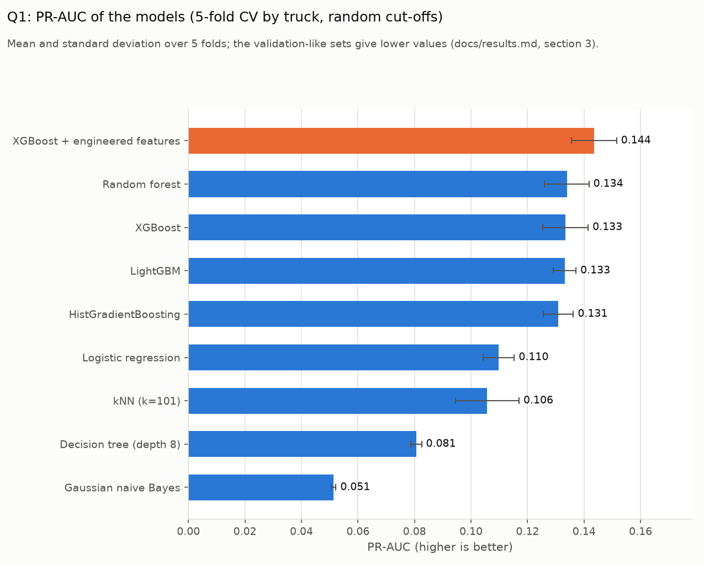
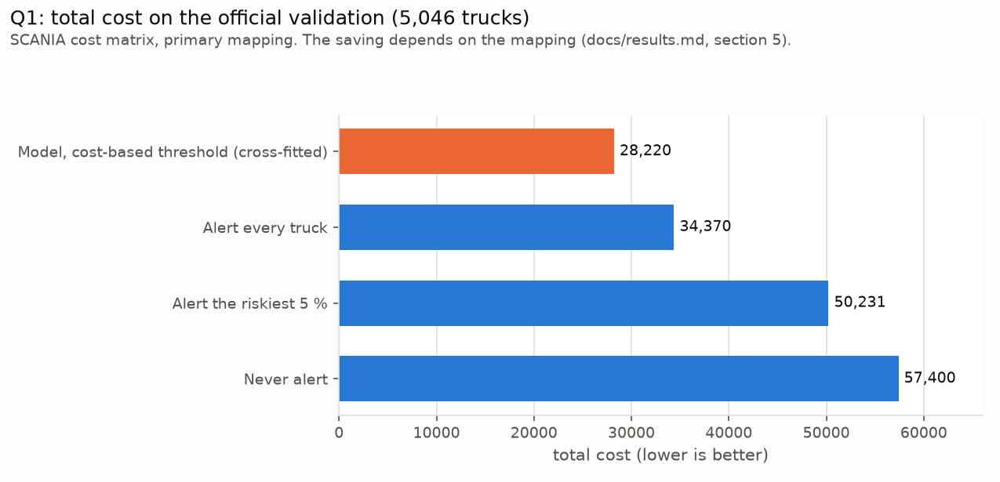

# FailSense

[](https://github.com/daneeshwalika-hash/failsense/actions/workflows/ci.yml)
[](LICENSE)

End-to-end predictive maintenance system on real truck fleet data: predicts component failures, estimates remaining useful life (RUL), detects anomalies and explains its predictions.

> **Status (11.11.2026):** version 1.0, code complete. **Final test evaluation pending — scheduled after course
> review (17.11.2026).** Every number below comes from cross validation or from the official validation split.

## Requirements

- Linux or WSL2 (Ubuntu), Python 3.12 (uv installs it from `.python-version`), [uv](https://docs.astral.sh/uv/).
- **System package `libgomp1` (OpenMP runtime) is required for LightGBM** on Linux:

  ```bash
  sudo apt install libgomp1
  ```

  Without it `import lightgbm` fails with `OSError: libgomp.so.1: cannot open shared object file`.
  That breaks the model-comparison tests, `make test` and the pre-commit pytest hook. A fresh
  WSL Ubuntu does not have the package; GitHub's `ubuntu-latest` runner already does.

## Quickstart

```bash
make setup      # uv sync + pre-commit hooks
make data       # download NASA C-MAPSS, prepare SCANIA Component X (manual download, see below)
make parquet    # CSV -> Parquet copies (faster to load)
make validate   # check all SCANIA files against the data contract
make test       # pytest (needs no raw data)
make cv         # cross validation of the baseline models, logged to MLflow
make train      # fit the reference model on the training split, logged to MLflow
make help       # all targets
```

`make leakage` runs only the data-leakage tests (`pytest -m leakage`).

### From zero to a running API

*Verified on a clean clone: pending (17.11.2026). The order below is read from the `Makefile` and the code.*

The API serves `models:/failsense-q1@candidate` from the **local MLflow registry** (`mlflow.db` and `mlartifacts/`,
both git-ignored). A fresh clone has no registry, so `make serve` alone cannot work. There are three ways to get one.

**A. With the data (the full path, trains the served model again):**

```bash
make setup       # 1. uv sync + pre-commit hooks
make data        # 2. C-MAPSS download; SCANIA from the zip you copied to data/raw/scania/ (see "Data")
make parquet     # 3. CSV -> Parquet copies in data/processed/scania/
make validate    # 4. data contract of all SCANIA files
make train       # 5. logistic-regression reference -> MLflow (optional for serving: a first end-to-end check)
make register    # 6. fits the chosen XGBoost recipe (reports/evaluate_q1_winner.json) on the training split
                 #    and registers it as failsense-q1, alias "candidate"
make calibrate   # 7. calibrator + cost-based threshold for THIS registered model (official validation)
make serve       # 8. the API on http://127.0.0.1:8000 (docs: /docs)
make dashboard   #    optional, second terminal: Streamlit on http://127.0.0.1:8501
```

**After `make register` on a new machine always run `make calibrate`.** A new registry numbers the newly trained
model "version 1" again, and the API's guard compares that version number, not the model itself; the committed
calibrator and threshold belong to the author's model, and only `make calibrate` ties them to yours.
`make register` and `make calibrate` rewrite files in `reports/` (`registry_q1.json`, `calibration_q1_*`,
`threshold_q1.csv`, two figures): on your clone `git status` is not clean afterwards, which is expected.
`make tune` and `make evaluate` (hyperparameter search and the choice of the recipe) are not needed: their result
is committed.

**B. Without training (the bundled model, exactly the one the committed calibrator belongs to):**

```bash
make setup
uv run python -m failsense.models.seed_registry   # registers models/failsense-q1 (SHA-256 checked) as version 1
make serve
```

No data is needed for the API itself; the dashboard additionally needs the validation Parquet files (steps 2-3 of A).

**C. With Docker:** `docker compose up --build` starts an MLflow server, the same seed step, the API and the
dashboard (section "Docker compose" below).

Dependency notes:

- **XGBoost is installed as `xgboost-cpu`** (CPU-only build, same `import xgboost`). The plain
  `xgboost` package pulls NVIDIA NCCL libraries on Linux, which a CPU project does not need;
  this matters for the size of the Docker image.
- **LightGBM needs the system package `libgomp1`** (see Requirements above).
- **Docker:** `python:*-slim` images do not contain `libgomp1` either; the Dockerfile installs it
  (see the Docker section below), otherwise `import lightgbm` fails inside the container.

## Limitations (read this before the results)

* **Q1 ranks only weakly better than chance** (PR-AUC 0.065 vs. base rate 0.027). The cost saving comes from the
  cost matrix: the cost-optimal decision alerts 59 % of the trucks (precision 3.9 %, recall 85 %).
* **Q2 does not resolve the urgency classes:** 88 % of healthy trucks and all failures land in class 4.
* **The anomaly detectors (Q4) are near random** (PR-AUC 0.030-0.032 vs. 0.027).
* **The drift check misses a x3 shift of the counters with 200 rows** (flags x10 and above); output drift only.
* **The test split has not been evaluated.** Final test evaluation pending — scheduled after course review
  (17.11.2026). The validation split was also used to choose the alert threshold, so its numbers are slightly
  optimistic.
* **The German LLM report needs its checks.** The first real answer of the local LLM passed the schema, factor and
  language checks and still contained invented numbers (section "German maintenance report").
* Details: [docs/results.md](docs/results.md) section 9 and the [model card](docs/model_card.md).

## Results so far

**Full results with tables, figures and limitations: [docs/results.md](docs/results.md)** (results of 09.11.2026,
text revised 11.11.2026). The sections below are the short version.

> **Test results:** Final test evaluation pending — scheduled after course review (17.11.2026). The single, frozen
> evaluation of Q1, Q2 and RUL on the test splits will be reported here and in `docs/results.md`, whatever it shows
> (section "Final test evaluation" below).

Q1 (will Component X need a repair within 48 time steps?) on the SCANIA **training** split:
5-fold cross validation, folds grouped by truck, 5 random cut-offs per truck, PR-AUC
(average precision). The test split has not been used for any model, threshold, calibrator or feature choice
(what exactly has read the test files: [Data](#data)).




*(`make figures` redraws all result figures from the saved reports; nothing is refitted.)*

| Model | Validation PR-AUC | Training PR-AUC | Gap |
|---|---|---|---|
| Dummy (always the prior, = share of positives) | 0.0276 | 0.0276 | 0 |
| Logistic regression, 106 raw features | 0.1014 ± 0.0047 | 0.1094 | +0.008 |
| + truck specifications | 0.1013 ± 0.0069 | 0.1147 | +0.013 |
| + `log1p` on counters and histogram counts (**linear reference**) | 0.1098 ± 0.0055 | 0.1254 | +0.016 |
| XGBoost, 300 rounds, untuned (no early stopping) | **0.1335 ± 0.0080** | 0.5147 | +0.381 |
| XGBoost + engineered features | **0.1435 ± 0.0080** | 0.6124 | +0.469 |
| MLP (64-32, early stopping, scaled) | 0.0992 ± 0.0101 | 0.7109 | +0.612 |

- The linear reference is about 4× better than the Dummy, but its score is **low**: a linear
  model is limited by bias (learning curve, `docs/problem_framing.md` §6). Tree ensembles
  (random forest, HistGradientBoosting, XGBoost, LightGBM) are clearly better (+0.021 to
  +0.024, better in 5 of 5 folds) and indistinguishable from each other; they are not tuned
  yet, and their large train/validation gap shows it.
- `log1p` is the only change so far that wins in every fold (+0.0086 ± 0.0053, 5/5 folds; the paired gain
  comes from an earlier run, where the reference scored 0.10988; the table shows the saved report
  `reports/compare_models_q1.csv`, 0.10985, a difference in the fifth decimal between two runs).
  Engineered features (counter rates, histogram shares), SMOTE, and the specifications gave
  no real gain for the linear model.
- **The scores above come from a cross validation on random cut-offs (folds grouped by truck) and are too
  optimistic; the gap was a distribution mismatch, not leakage.** The random cut-offs lie much earlier in a
  truck's history than the last readouts the official validation asks about. On a
  validation-like evaluation set (same `time_step` distribution and positive rate as the
  official validation) XGBoost scores about **0.05–0.09** PR-AUC and the logistic regression
  0.04–0.08, with the same ranking (`docs/problem_framing.md` §6, "Evaluation protocol"). The
  official validation histories are longer than a uniform cut of training histories would give
  (82 % vs. about 51 %), so the `time_step` shift is a property of the data. From here on,
  models are scored on the validation-like set; the official validation is the real check.
- A **candidate model** is registered in the local MLflow registry as `failsense-q1` (alias
  `candidate`): XGBoost with 125 engineered features, untuned (a hyperparameter search with Optuna
  found nothing clearly better). On the validation-like evaluation set it reaches PR-AUC 0.057 and
  ROC-AUC 0.66; alerting the riskiest 5 % of the trucks finds 15 % of the failures at 8 % precision
  (about 3 × the base rate).
- **First look at the official validation** (136 of 5,046 trucks positive, test untouched):
  PR-AUC 0.065 (95 % interval 0.048–0.102), ROC-AUC 0.70. The raw probabilities are about 4 × too
  high; a sigmoid calibrator fitted without validation labels brings the Brier score to the level of
  the base rate (0.026) but adds no skill over it. With the SCANIA cost matrix, "alert every truck"
  costs 34,370 (4,910 × 7); the cross-fitted cost-optimal threshold costs 28,220 (saving 6,150 =
  1.22 per truck, better in 5/5 folds), alerting only the riskiest 5 % costs 50,231. Under the
  stricter reading "alert = predicted class 1" the model is no better than never alerting
  (`make calibrate`, `docs/problem_framing.md` §6).
- **Deployment choice (06.11):** label-free sigmoid calibrator + alert threshold 0.0353 learned on the
  whole validation set; quote the cross-fitted cost 28,220, not the in-sample one. The saving depends
  on the primary cost mapping (an alert on a failing truck is free); under "alert = predicted class
  1" the model saves only 148 vs. never alerting. The test split is still untouched.
- **Explanations (SHAP, `make explain`):** on the validation only two histogram groups (459, 291) lose
  PR-AUC clearly when shuffled; the group with the largest SHAP and gain (397) does not. SHAP values are
  in raw log-odds of the uncalibrated model; `top_shap_factors` returns the top features per truck.
- **Q2 (classes 0–4, 5 × 5 cost matrix, 09.11, [ADR 0004](docs/adr/0004-q2-prior-shift.md)):**
  multi-class XGBoost with a prior-shift correction (the training and validation class mixes
  differ). Total cost 43,871 vs. 49,566 for the best constant predictor ("always class 4"); the
  correction is within noise of the uncorrected model (44,280) but improves the log loss. **The
  urgency classes are not resolved**: 88 % of healthy trucks and all positives land in class 4,
  because a false alarm costs only 7–10 (macro F1 0.05). The cost is optimistic by construction
  (validation mix used for the correction).
  
  
- **Unsupervised view (09.11):** PCA + KMeans on the training trucks show weak structure (k = 2,
  silhouette 0.27); the clusters follow the truck specification, not failures (normalised mutual
  information with repairs 0.007).
- **Q4 anomaly detection (09.11, [ADR 0005](docs/adr/0005-anomaly-score-feature-rule.md)):** IsolationForest and
  LOF fitted on healthy trucks only are close to a random ranking on the validation (PR-AUC 0.030-0.032 vs.
  prevalence 0.027; the supervised model reaches 0.065-0.069). As an extra feature the anomaly score
  gives +0.0068 PR-AUC (interval includes 0): the pre-registered rule is met, the evidence is weak, and
  nothing was re-registered.
- **Served model:** the API, dashboard, Docker image, prediction log and stream simulator are
  described in the sections below; they use the Q1 model and its calibrated threshold.
- **Q5 (why, and what should the technician do?)** is built: `POST /explain` returns the top SHAP factors and,
  on request, a checked German maintenance report from a local LLM (sections below). No target for the total cost
  is set.

**Q3 (remaining useful life) on NASA C-MAPSS FD001**, training engines only, 5-fold
`GroupKFold` by engine, RUL capped at 125 cycles, RMSE in cycles (lower is better); the
test file is untouched:

| Model | Validation RMSE | Training RMSE | MAE |
|---|---|---|---|
| Dummy (mean) | 41.67 ± 0.00 | 41.67 | 36.97 |
| Ridge (alpha 1) | 21.64 ± 1.38 | 21.44 | 17.72 |
| Lasso (alpha 0.1) | 21.63 ± 1.38 | 21.44 | 17.72 |

A linear model halves the error of the mean predictor. Ridge and Lasso are identical (the Ridge alphas
0.1 to 100 tie at 21.64; alpha 1 is the configured value, `rul.ridge_alpha`); Lasso only switches off the
7 constant columns (`setting_3` and the 6 constant sensors). Details in the docs; this is simulated data.

**Time-series features (09.11):** trailing rolling mean / std over 5 and 15 cycles (past cycles of the same
engine only) and LightGBM, same folds: Ridge 21.6 → Ridge + rolling 19.6 → LightGBM 18.7 → **LightGBM +
rolling 18.1 ± 0.8** (better than the Ridge reference in 5/5 folds). LightGBM overfits (train RMSE 10.4) and
is not tuned. The score is over all cycles of held-out training engines, not the official test protocol.


Details, decisions and the evaluation protocol: [docs/problem_framing.md](docs/problem_framing.md).

## Prediction API

```bash
make serve          # scripts/serve.sh: loads models:/failsense-q1@candidate, docs at /docs
```

* `GET /health` - status and the loaded model (name, registry version, alias).
* `POST /predict` - body: `current` readout (`time_step` + the 105 raw columns, `null` allowed),
  optional `previous` (the readout of the **same truck immediately before** `current`:
  `time_step` + the 8 counters), and the truck `specifications` (`Spec_0` ... `Spec_7`).
  Response: calibrated `risk`, `alert` (risk >= the cost-based `threshold`), model version.
  The raw model score is never returned. Without `previous` the deltas are NaN, as for the
  first readout of a truck in training. Label columns are rejected (HTTP 422).

* `POST /predict/batch` - `{"items": [...]}` with 1-100 `/predict` bodies; one model call, answers in the
  order of the items, every item logged; one invalid item rejects the whole request (422 names the index).
* `POST /explain` - the same body plus `top_k` (1-20, default 5). Returns the risk, the alert and the `top_k`
  inputs that moved the calibrated risk most (SHAP, contribution in calibrated log-odds, `raises` / `lowers`) and the
  model's start value `baseline_risk` (the SHAP base value as a calibrated risk, **not** the fleet's average risk):
  `logit(risk) = logit(baseline_risk) + sum of all contributions`. It describes
  what the model uses, not what causes a failure; explanation requests are not written to the prediction log.

The service refuses to start if the calibration summary was made for another model than
`models:/<tuning.registered_model>@<tuning.alias>`.

### Docker

```bash
docker build -t failsense-api .
docker run --rm -p 8000:8000 -v "$PWD/mlflow.db:/app/mlflow.db" \
  -v "$PWD/mlartifacts:$PWD/mlartifacts" failsense-api
```

Multi-stage image (uv, `uv sync --locked --no-default-groups`: no dev tools, no Streamlit), `libgomp1` for
LightGBM/XGBoost, CPU-only `xgboost-cpu`, runs as a non-root user (uid 10001). It contains code, config, the
calibration summary and one small bundled copy of model version 1 (`models/failsense-q1`, 1.2 MB) that is used only to
seed an empty MLflow registry; it contains **no data**. The served model is always loaded from the MLflow registry at
startup, never from the bundle directly.
MLflow stores artifact paths as absolute URIs, hence the second mount at the host path; the
docker compose stack below (MLflow server + seed step) removes this detail. CI builds the image and
imports the app inside it.

## Dashboard

```bash
make serve       # terminal 1: the API
make dashboard   # terminal 2: Streamlit on http://127.0.0.1:8501
```

Pick a demo truck (a fixed sample of the **validation** split, never the test split), see the
calibrated risk, the cost-based alert threshold, the risk of the latest readouts and the
known outcome. The page never loads the model: every number comes from `POST /predict`
(`FAILSENSE_API_URL` changes the API address). Streamlit lives in the `dashboard` dependency
group (installed by `uv sync`, not part of the API image).

### Prediction log and stream simulator

Every `POST /predict` is appended to a DuckDB file (`logs/predictions.duckdb`, git-ignored, set by
`api.prediction_log`; the raw score is not stored). Only the API process opens the file;
`GET /predictions/latest?limit=20` returns the newest rows and feeds the dashboard table.

```bash
make simulate    # 200 readings, 1 per second, to the running API
uv run python scripts/simulate_stream.py --interval 0.2 --drift-start 60 --drift-factor 2
```

The simulator replays the last readouts of validation trucks (each with its previous readout) in
random order; `--drift-start` scales the counters up gradually, a fleet used harder than the
training data, for the drift check below to detect (with 200 rows it flags a x10 shift and misses a x3
shift). The test split is never used.

### German maintenance report (local LLM)

`POST /explain` with `"with_report": true` (and the button "Wartungsbericht erzeugen" in the dashboard) returns a
German report: a local LLM (Ollama, `llm.model` in the config, default `qwen2.5:7b`) **phrases** the prediction
and the top SHAP factors; it never sees raw readouts and never decides the risk level. The answer is checked
before anyone sees it: valid JSON for the schema, every cited factor is one of the given factors, the risk level
equals the one computed from risk and threshold, and the text is German. If Ollama is missing, too slow, or the
answer fails the checks twice, a **template report** is returned (`report.source = "fallback"`), so the endpoint
never fails and never shows an unchecked text. The variables are anonymised, so the report only says that a factor
raises or lowers the model's risk, never why a part fails. The prompt is `prompts/maintenance_report_de.md`.

```bash
curl -fsSL https://ollama.com/install.sh | sh   # install Ollama (Linux), see docs.ollama.com/linux
ollama pull qwen2.5:7b                           # ~4.7 GB; CPU-only inference takes a while
ollama serve                                     # or: sudo systemctl start ollama
```

`OLLAMA_BASE_URL` overrides the address (e.g. `http://host.docker.internal:11434` from a container);
`llm.enabled: false` returns only the template report.

**What the real LLM taught us (09.11.2026, `qwen2.5:7b` on CPU, 69-110 s per report).** The first real answer was
valid JSON, cited only given factors and was German, so every check passed, and it still contained invented
numbers: "0.3 % über der Alarmschwelle" for 4.4 % against 3.5 % (the difference is 0.9 points) and log-odds
contributions written as percent. The validator therefore also checks numbers: every percentage in the text must be
one of the given facts, the LLM must not compare numbers at all (the comparison sentence is built in code from the
unrounded facts and put in front of its summary), and an answer that fails twice is replaced by the deterministic
template. In the third live run the first attempt was rejected and the second was accepted. Lesson: valid and grounded
is not the same as correct; let the model phrase and let code compute. Since 11.11.2026 the SHAP base value is called
"Startwert des Modells (SHAP-Basiswert)" instead of an average; that wording is covered by tests with a fake client
and has not been run against the live LLM again.

### Monitoring: drift check and coverage

```bash
make drift-reference   # reference: risks of the deployed model on the validation last readouts
make drift-check       # PSI + KS test of the API's recent predictions vs. the reference (exit 0/1/2/3)
make coverage          # tests with a coverage report (also printed in CI)
```

The drift check looks at the distribution of the answered risk only (the log has no inputs). With 200 rows it
flags a x10 shift of the counters but not a x3 shift; see `docs/results.md` section 13 and
[ADR 0006](docs/adr/0006-monitoring-without-evidently.md) (why Evidently was not added). Replay the validation
last readouts with `uv run python scripts/simulate_stream.py --tail 1` to compare like with like.

### Docker compose (MLflow server + seed + API + dashboard)

```bash
cp .env.example .env     # optional: OLLAMA_BASE_URL (default http://host.docker.internal:11434)
docker compose up --build   # or: make compose-up
docker compose down         # stop (named volumes keep the registry and the prediction log)
```

A clean machine works with nothing but the repository and the three validation Parquet files in
`./data/processed/scania` (`validation_operational_readouts`, `validation_specifications`, `validation_labels`; created
by `make parquet`). Only these three files are mounted into the dashboard container, read-only; no test file is
visible there:

* `mlflow` - the registry, started from the API image so the server and client versions cannot differ.
  `MLFLOW_SERVER_ALLOWED_HOSTS=mlflow:5000,localhost:*,127.0.0.1:*`: MLflow >= 3.5 validates the `Host` header
  (DNS-rebinding protection) and by default allows only localhost and private IPs, so a call to
  `http://mlflow:5000` answers 403 "Invalid Host header". The list names exactly the hosts in use (the port is part
  of an entry); `*` would switch the protection off and is not used.
* `seed` - one-shot: if the registry has no `failsense-q1@candidate`, it logs the bundled model
  (`models/failsense-q1/`, 1.2 MB, SHA-256 checked) **through the server** (MLflow stores absolute `file://`
  artifact paths that do not exist in a container) and sets the alias. A registry that already has the alias is
  left alone.
* `api` - waits for the seed, loads the model by name and alias; the fail-fast checks stay (summary for another
  model or another version -> it refuses to start).
* `dashboard` - Streamlit, talks to the API only.

Ollama runs on the host. `OLLAMA_BASE_URL` (in `.env`) is where the API finds it; on Windows Ollama listens on
`127.0.0.1` only by default, so start it with `OLLAMA_HOST=0.0.0.0` (and allow the firewall prompt), otherwise the
API uses the template report. `make publish-model` copies a NEWER locally registered model into the server; a new
version also needs `make calibrate`, or the API refuses it.

**Status:** the stack was started on the author's machine on 09.11.2026 (fresh volume: MLflow healthy -> seed
registered version 1 -> API healthy -> dashboard; the German report came from Ollama on the host). CI builds both
images and validates the compose file; the seed path (empty registry -> seed -> the production loader) and the
Host-header behaviour are also tested without Docker. The read-only file mounts of the dashboard were changed on
11.11.2026 (three validation files instead of `./data`) and have not been started since: check pending (17.11.2026).

### Retraining and the model card

```bash
make retrain      # champion vs. challenger on a fixed holdout (dry run); promote only with 95 % confidence
```

The tuned challenger is **not** clearly better than the registered recipe (cost -518 ± 759 on the holdout, interval
includes 0), so the champion stays ([ADR 0007](docs/adr/0007-champion-challenger-promotion.md)). A promoted
version needs a new calibrator (`make calibrate`); the API refuses a version the calibration summary does not name.
Intended use, data, metrics and limits of the deployed model: [docs/model_card.md](docs/model_card.md).

## Final test evaluation

**Final test evaluation pending — scheduled after course review (17.11.2026).** The test splits (SCANIA and C-MAPSS)
are evaluated exactly once, with frozen models, a frozen calibrator and a frozen threshold; the plan and the six
decisions fixed in advance are in [docs/test_evaluation_plan.md](docs/test_evaluation_plan.md). Order on the test day:

```bash
uv run python -m failsense.freeze --replace   # 1. re-freeze on the final commit (training data only), commit the manifest
make freeze-verify                             # 2. hashes, config, library versions, clean git tree
make rehearse                                  # 3. REHEARSAL on the VALIDATION split: no lock, no test file opened
uv run python scripts/evaluate_test_once.py --approved-single-run   # 4. the single run (only with approval)
```

`make rehearse` runs the same code path on the validation split and must reproduce the known validation numbers of
the frozen Q1 model (5,046 trucks, 136 positives, PR-AUC 0.0653, 3,013 alerts, cost 27,565 at the frozen threshold);
it writes its result to the log and to the system temp folder, never into the repository. Before the lock is created
the single run loads and checks every frozen model, so a broken file cannot use up the run. Between the freeze and
the single run nothing may be written into the repository (`git status` must be empty; no `make drift-check`, no
`make figures`).

## License

The code of this repository is released under the [MIT License](LICENSE), Copyright (c) 2026 Daneesh Walika.
The datasets are not part of the repository and keep their own terms (section "Data").

## Future work

- **Bosch CNC Machining: cross-machine anomaly detection on real vibration data.** Cut from v1.0 on
  06.11.2026 to protect the Must items; planned only after the presentation on 20.11.2026, with a
  split by machine (never random), FFT features and the same anomaly-detection setup as for SCANIA.
  Reasons and the plan to resume: [ADR 0003](docs/adr/0003-cut-bosch-cnc.md). The dataset is not
  used yet, so it is not listed under Data.

## Data

| Dataset | Used for | Source | Licence / terms |
| --- | --- | --- | --- |
| SCANIA Component X (real truck fleet) | Failure classification, cost-based threshold, anomaly detection | Swedish National Data Service (SND), [doi:10.5878/jvb5-d390](https://doi.org/10.5878/jvb5-d390) | Open access; cite the dataset and the paper below |
| Turbofan Engine Degradation Simulation (C-MAPSS, FD001) | Remaining useful life (RUL) | NASA Prognostics Data Repository, [PCoE data set page](https://www.nasa.gov/intelligent-systems-division/discovery-and-systems-health/pcoe/pcoe-data-set-repository/) (also [data.nasa.gov](https://data.nasa.gov/dataset/cmapss-jet-engine-simulated-data)) | **No licence stated** on the NASA pages (the catalog entry says "License not specified"); users are asked to acknowledge the repository and the data donators, and use the data at their own risk. Simulated data, not real engines |

Raw data is never committed; `scripts/download_data.sh` prepares it in `data/raw/`.

**What "test split untouched" means here.** `make parquet`, `make validate` and the EDA notebook read test files
only for format conversion and schema checks; no model, threshold, calibrator or feature choice uses them, and the
test labels have never been loaded for an analysis. The single evaluation on test is frozen and locked
([docs/test_evaluation_plan.md](docs/test_evaluation_plan.md), section 1a lists every reader); tests fail if a
training entry point opens a file named `test_*` or `RUL_FD*`.

**SCANIA Component X (~1.5 GB) needs one manual download:**
open the [SND catalogue page](https://researchdata.se/en/catalogue/dataset/2024-34),
download all files as a zip, copy the zip into `data/raw/scania/` and run `make data`.
The script extracts the archive, checks that all nine files exist and verifies the SHA-256
of `train_operational_readouts.csv`.

Why real data instead of the popular synthetic AI4I 2020 dataset: see
[ADR 0001](docs/adr/0001-dataset-switch.md).

### Citations

- Kharazian, Z., Lindgren, T., Magnússon, S., Steinert, O., & Andersson Reyna, O. (2025).
  SCANIA Component X dataset: a real-world multivariate time series dataset for predictive
  maintenance. *Scientific Data*, 12, 493. https://doi.org/10.1038/s41597-025-04802-6
- Lindgren, T., Steinert, O., Andersson Reyna, O., Kharazian, Z., & Magnússon, S. (2024).
  SCANIA Component X Dataset: A Real-World Multivariate Time Series Dataset for Predictive
  Maintenance [Data set]. Scania CV AB. https://doi.org/10.5878/jvb5-d390
- Saxena, A., & Goebel, K. (2008). *Turbofan Engine Degradation Simulation Data Set*. NASA
  Prognostics Data Repository, NASA Ames Research Center, Moffett Field, CA
  (citation text as given on the NASA PCoE data set page; no DOI is stated).
- Saxena, A., Goebel, K., Simon, D., & Eklund, N. (2008). Damage propagation modeling for
  aircraft engine run-to-failure simulation. *International Conference on Prognostics and
  Health Management (PHM 2008)*.

Acknowledgment: the C-MAPSS data was provided by the NASA Ames Prognostics Center of
Excellence (PCoE) through the NASA Prognostics Data Repository; thanks to NASA and the
donators of the data. NASA states that users employ the data at their own risk.
