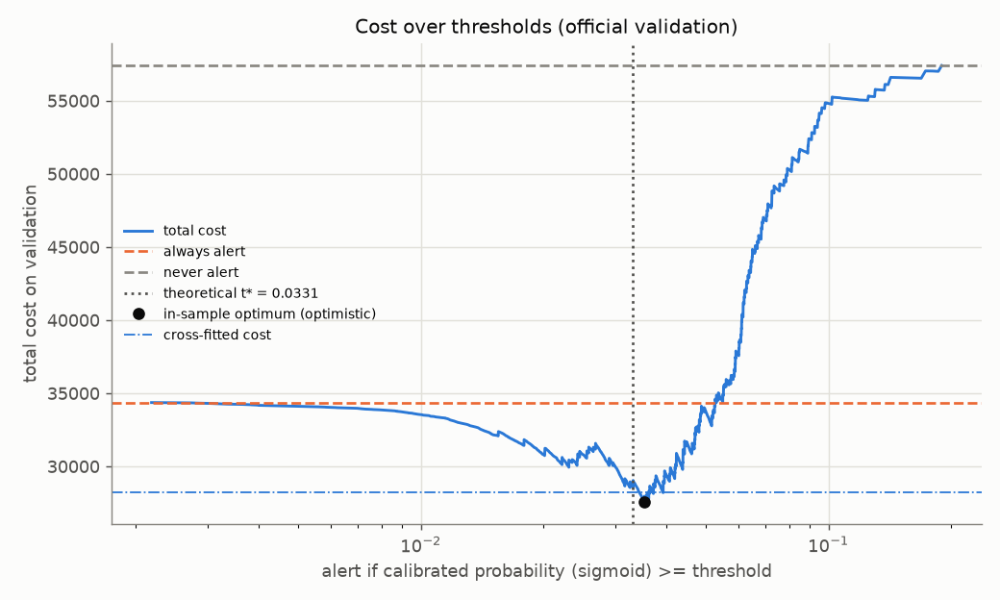
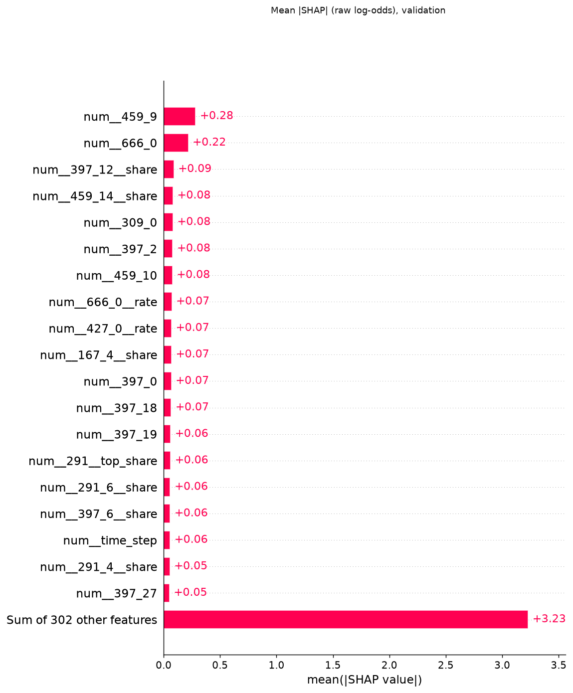

# Results — FailSense (status 09.11.2026)

All numbers below come from files in `reports/` or from the MLflow runs (experiments `failsense-q1-binary`,
`failsense-rul`, `failsense-q2-classes`, `failsense-anomaly`, `failsense-unsupervised`,
`failsense-retrain`); the source is named next to each table. Design, decisions and the history of every
choice are in [problem_framing.md](problem_framing.md). **The test split has not been used.**

## 1. Summary

1. **Business result (official validation, 5,046 trucks, 136 failing):** with the SCANIA cost matrix the
   deployed alert policy costs **28,220** (cross-fitted), against **34,370** for "alert every truck":
   a saving of **6,150 (18 %, 1.22 per truck), better in 5/5 folds**; never alerting costs 57,400.
2. The policy alerts 2,976 trucks (recall **85 %**, precision 3.9 %) and **skips 2,070 trucks, among
   them 20 of the 136 failing ones** (class 1: 2, class 2: 2, class 3: 8, class 4: 8).
3. **The model ranks, but its probabilities add no skill over the base rate** (PR-AUC 0.065, ROC-AUC 0.70,
   Brier 0.026 = base rate); the honest benchmark is "alert everybody", because a miss costs 200–500 and
   a false alarm 7.
4. **Caveat (mapping a):** the saving assumes an alert on a failing truck costs 0. If an alert is read as
   "predicted class 1" (mapping b), the model saves only **148** vs. never alerting. The positive result
   depends on mapping (a).
5. The test split is untouched and is used once, at the very end. Deployed: sigmoid calibrator fitted
   without validation labels + threshold 0.0353 learned on the whole validation (the cost to quote is the
   cross-fitted 28,220, not the in-sample 27,565).

Source: `reports/calibration_q1_summary.json` (`deployment_choice`, `primary_baselines`,
`primary_decision_cross_fitted`, `sensitivity_literal`), `reports/threshold_q1.csv`.

**Since 06.11 (sections 10-14):** Q2 classes 0-4: cost 43,871 vs. 49,566 for the best constant, urgency classes
not resolved (section 11). Q4: anomaly detectors on healthy trucks are close to a random ranking; as an extra
feature +0.0068 PR-AUC with an interval that includes 0 (section 12). Q3 RUL: Ridge 21.6 -> LightGBM with rolling
features 18.1 RMSE (section 8). The MLP does not beat logistic regression or XGBoost (section 3). Serving: API,
dashboard, prediction log, drift check (misses a x3 counter shift), docker compose (not started here), coverage
83 % (section 13). Retraining: the tuned challenger is not clearly better than the champion (section 14).

## 2. Evaluation protocol

**Random-row cross validation was too optimistic.** The first protocol (5-fold CV, folds grouped by truck,
random cut-offs) gave PR-AUC 0.13 for XGBoost, but its cut-offs lie far earlier in a truck's history than
the official validation's last readouts (median `time_step` 83 vs. 169, KS 0.425). On an evaluation set
that imitates the validation, the same models score 1.4–2.5 × lower:

| Model | Old CV (random rows) | Calibrated validation-like set | Literal set | Factor |
|---|---|---|---|---|
| XGBoost | 0.1335 ± 0.0080 | 0.0530 ± 0.0045 | 0.0901 ± 0.0161 | 2.5 / 1.5 |
| Logistic regression | 0.1098 ± 0.0055 | 0.0444 ± 0.0031 | 0.0781 ± 0.0076 | 2.5 / 1.4 |

Source: `reports/eval_old_vs_new_q1_calibrated.csv`, `reports/eval_old_vs_new_q1_literal.csv`,
`reports/time_step_check_q1.csv`.

**Three ways to build an evaluation set** (`reports/eval_set_methods_q1.csv`): *calibrated* rank matching
reproduces both the validation's `time_step` distribution (KS 0.008) and its positive rate (2.696 % vs.
2.695 %); *literal* (one random readout per truck) matches the rate (2.61 %) but not the `time_step`
distribution (KS 0.31); plain rank matching matches the distribution (KS 0.012) but gives a 9.6 % positive
rate. The calibrated set is the main protocol, the literal set the second reference.

**Class-mix finding (06.11).** The calibrated set has 607 / 26 / 2 / 0 positives in classes 1–4, the
official validation 16 / 14 / 30 / 76:

| Set | Positive rate | Class 1 / 2 / 3 / 4 |
|---|---|---|
| official validation (reference) | 2.70 % | 16 / 14 / 30 / 76 |
| literal (one uniform readout per truck) | 2.61 % | 281 / 158 / 71 / 104 |
| **calibrated rank matching** | 2.70 % | **607 / 26 / 2 / 0** |

Source: `reports/class_mix_check_q1.csv`. The matching pairs each truck with the validation `time_step`
quantile of its reach rank; the training reach is about 41–46 steps above the target at every quantile,
about the 48-step horizon, so repaired trucks are placed at 39–44 steps before the repair (class 1). So the
calibrated set measures **mostly class-1 early warning**; the official validation is mostly imminent
failures (56 % class 4). Readouts are not denser near the repair (0.23–0.28 per time unit in every window),
and a shifted reference point does not explain the validation's mix. Consequences are in section 9.

## 3. Model comparison

PR-AUC, 5 folds grouped by truck, same folds for every model, old CV (random cut-offs). The base rate
(a classifier that ignores the features) is 0.0276.

| Model | PR-AUC (mean ± std) | Train PR-AUC | Paired vs. logreg (folds won) |
|---|---|---|---|
| Dummy (prior) | 0.0276 ± 0.0000 | 0.0276 | – |
| Logistic regression (L2, balanced, `log1p`, specs) | 0.1098 ± 0.0055 | 0.125 | reference |
| kNN (k = 101, distance) | 0.1057 ± 0.0113 | – | −0.0041 (2/5) |
| Gaussian naive Bayes | 0.0514 ± 0.0008 | 0.053 | −0.0585 (0/5) |
| Decision tree (depth 8) | 0.0806 ± 0.0020 | 0.128 | −0.0293 (0/5) |
| Random forest | 0.1339 ± 0.0079 | 0.748 | +0.0240 (5/5) |
| HistGradientBoosting | 0.1309 ± 0.0054 | 0.917 | +0.0210 (5/5) |
| XGBoost | 0.1335 ± 0.0080 | 0.515 | +0.0236 (5/5) |
| LightGBM | 0.1331 ± 0.0040 | 0.928 | +0.0233 (5/5) |
| XGBoost + engineered features (deployed recipe) | **0.1435 ± 0.0080** | 0.612 | +0.0337 (5/5) |
| MLP (64-32, early stopping), raw features | 0.0992 ± 0.0101 | 0.711 | -0.0107 (1/5) |
| MLP + engineered features | 0.0958 ± 0.0098 | 0.833 | – |

Source: `reports/compare_models_q1.csv` and, for the MLP rows, `reports/compare_mlp_q1.csv` (`make mlp`, same folds, refitted
references reproduce 0.1098 / 0.1335 / 0.1435 exactly; MLflow tag `comparison_set = v3_mlp`) (Dummy: MLflow runs `dummy_prior_k5`; engineered row:
`reports/compare_models_q1_recheck.csv`). The four boosting and forest models are tied with each other;
all beat the linear model in 5/5 folds. The large train/validation gaps of the trees show overfitting.
**The MLP is not competitive** (09.11): standard scaling + `log1p`, two hidden layers (64, 32), L2 penalty, early stopping.
It is worse than the logistic regression (-0.0107 ± 0.0138, better in 1/5 folds) and clearly worse than XGBoost
(-0.0343 ± 0.0151, 0/5; with engineered features -0.0478 ± 0.0092, 0/5). It overfits (train 0.71-0.83 vs. validation
0.10) and the engineered features do not help it (-0.0034, 3/5 folds, noise). With ~117,000 tabular rows, 2.8 % positives
and heavy-tailed counters, boosted trees remain the right tool; the network was not tuned (no search over width, depth
or penalty). The early-stopping split inside `MLPClassifier` is by row, not by truck (the class cannot take groups); the
reported PR-AUC comes from the outer grouped CV.

Without the specs (−0.0069, 0/5 folds) or without `time_step` (−0.0061, 0/5) XGBoost is worse; engineered
features help (+0.0101, 4/5).

On the validation-like sets (the protocol from 05.11 on; `reports/evaluate_q1.csv`,
`reports/eval_old_vs_new_q1_*.csv`):

| Model | Calibrated set | Literal set |
|---|---|---|
| Logistic regression | 0.0444 ± 0.0031 | 0.0781 ± 0.0076 |
| XGBoost | 0.0530 ± 0.0045 | 0.0901 ± 0.0161 |
| **XGBoost + engineered (registered `failsense-q1` v1)** | **0.0570 ± 0.0062** | **0.0943 ± 0.0070** |

## 4. Hyperparameter search

Optuna (TPE, MedianPruner per fold, early stopping on a truck-grouped inner split) on the calibrated set;
XGBoost: 24 of 40 trials (12-minute cap), LightGBM: 40 trials. Source: `reports/evaluate_q1.csv`,
`reports/evaluate_q1_paired.csv`, `reports/evaluate_q1_winner.json`, `reports/hpo_q1_best_params.json`.

| Model | Calibrated PR-AUC | Paired vs. untuned (calibrated) | Literal PR-AUC | Paired vs. untuned (literal) |
|---|---|---|---|---|
| XGBoost tuned (best of 24) | 0.0585 ± 0.0093 | +0.0015 ± 0.0040 (3/5) | 0.0923 ± 0.0084 | −0.0020 ± 0.0083 (2/5) |
| LightGBM tuned (best of 40) | 0.0592 ± 0.0138 | +0.0022 ± 0.0100 (2/5) | 0.0860 ± 0.0067 | −0.0083 ± 0.0070 (1/5) |
| **XGBoost untuned, engineered** | 0.0570 ± 0.0062 | reference | 0.0943 ± 0.0070 | reference |

**Winner rule (fixed before the run):** a tuned model is registered only if its mean fold difference is
larger than the standard deviation of the differences **and** it wins in at least 4 of 5 folds on the
calibrated set. Neither model qualified (`"qualifying": []`), so the simpler **untuned engineered XGBoost
(300 rounds, learning rate 0.05, depth 4, no class weights)** is registered. The tuned scores are the best
of N trials chosen on the same folds they are scored on, hence optimistic; on the literal set both tuned
models are slightly worse.

## 5. Calibration and cost

All numbers on the **official validation** (5,046 trucks, 136 positives = 2.70 %).

**Probabilities** (source `reports/calibration_q1_scores.csv`; calibrators fitted label-free on
out-of-fold scores of the calibrated set, except the two `_cv` references):

| Variant | Brier | Log loss | Mean probability (true rate 0.027) | PR-AUC | ROC-AUC |
|---|---|---|---|---|---|
| raw model score | 0.0384 | 0.172 | 0.112 | 0.0653 | 0.703 |
| **sigmoid, label-free (primary)** | **0.0261** | 0.121 | 0.043 | 0.0653 | 0.703 |
| isotonic, label-free | 0.0262 | 0.122 | 0.044 | 0.0536 | 0.694 |
| sigmoid, cross-fitted on validation | 0.0258 | 0.117 | 0.027 | 0.0676 | 0.701 |
| isotonic, cross-fitted on validation | 0.0265 | 0.125 | 0.027 | 0.0533 | 0.685 |
| base-rate predictor | 0.0262 | 0.124 | 0.027 | – | – |

The PR-AUC of 0.0653 (95 % bootstrap interval 0.048–0.102) lies near the 05.11 calibrated estimate
(0.0570) and inside the interval of the literal one (0.0943), so the validation cannot rank the two
protocols. The raw score is about 4 × too high; the label-free sigmoid fixes most of it but stays 1.6 × too
high, and **no variant beats the base rate in Brier score**. Isotonic gives no gain.

**Cost** (primary mapping: false alarm 7, miss 200 / 300 / 400 / 500 for class 1 / 2 / 3 / 4, alert on a
failing truck 0; source `reports/calibration_q1_summary.json`, `reports/threshold_q1.csv`):

| Policy | Alerts | Total cost |
|---|---|---|
| never alert | 0 | 57,400 |
| **always alert (primary baseline)** | 5,046 | **34,370** |
| alert the riskiest 5 % | 253 | 50,231 |
| theoretical threshold t* = 0.033 on sigmoid probabilities | 3,235 | 28,612 |
| **cross-fitted cost-optimal threshold (sigmoid), reported** | 2,976 | **28,220** |
| in-sample optimum (optimistic) | 3,013 | 27,565 |

Cross-fitted saving vs. always alert: **6,150** in total, per fold 875 / 696 / 1,249 / 811 / 2,519
(mean 1,230 ± 750, 5/5 folds). One fold carries 41 % of the saving, so the bar "mean larger than the
spread" is low. The old "riskiest 5 %" policy is **worse than always alerting**. t* uses the class mix of
the calibrated set (training labels only; mean cost of a miss 205); the cross-fitted fold thresholds
(0.0353–0.0362) agree with it.

**Sensitivity — mapping (b), "alert = predicted class 1"** (an alerted truck of class k costs
`Cost_k_1` = 0 / 200 / 300 / 400): always alert costs 76,570, never alert 57,400, the cross-fitted policy
**57,252**, i.e. **148 less than never alerting**. Under this reading the model is practically worthless.

**Deployment choice (decided 06.11):** label-free sigmoid calibrator (slope 0.526, intercept −1.957 on the
logit of the raw score) and **threshold 0.0353** on the calibrated probability, learned on the whole
validation (`deployment_choice` in the summary JSON). The test split is used once at the very end.

## 6. Explainability

Model `failsense-q1@candidate`, official validation; source `reports/explain_q1_groups.csv`,
`reports/explain_q1_summary.json` (MLflow run `explain_q1`). SHAP values are contributions to the raw
log-odds of the **uncalibrated** model (base value −3.60, p = 0.027); the calibrated contribution is
0.526 × SHAP. Permutation importance shuffles a **group** of columns (all raw and engineered columns of
one variable) 20 times; "reliable" means mean − 2·std > 0. The spread is the shuffle noise only; the
sampling noise of 136 positives comes on top.

| Group | Columns | PR-AUC drop (baseline 0.0653) | Log-loss rise (baseline 0.1212) | Mean \|SHAP\| (rank) | Gain share |
|---|---|---|---|---|---|
| 397 (histogram) | 74 | −0.0023 ± 0.0067 (no) | +0.00132 ± 0.00036 (**yes**) | **0.630 (1)** | 23.5 % |
| **459 (histogram)** | 42 | **+0.0131 ± 0.0039 (yes)** | +0.00311 ± 0.00054 (yes) | 0.514 (2) | 18.2 % |
| 666 (counter) | 3 | +0.0090 ± 0.0054 (no) | +0.00173 ± 0.00052 (yes) | 0.211 (3) | 9.1 % |
| 167 (histogram) | 22 | +0.0076 ± 0.0046 (no) | +0.00118 ± 0.00034 (yes) | 0.170 (4) | 7.3 % |
| **291 (histogram)** | 24 | **+0.0077 ± 0.0025 (yes)** | +0.00072 ± 0.00029 (yes) | 0.137 (5) | 6.6 % |
| `time_step` | 1 | +0.0019 ± 0.0027 (no) | +0.00058 ± 0.00008 (yes) | 0.057 (11) | 0.4 % |
| Spec_0 | 1 | 0 | 0 | 0 (never used) | 0 % |

- **Permutation by PR-AUC** finds only two groups clearly above the spread, **459 and 291**; the other 20
  groups are inside it and are not ranked. **Grouped SHAP** ranks 397, 459, 666, 167, 291. They agree on 459
  and 291; the Spearman correlation over all 23 groups is 0.57. Gain has the same top three as SHAP but is
  biased (training data, favours columns with many split points, splits credit between correlated columns).
- **The 397 case:** group 397 is #1 by SHAP and gain, yet shuffling it does not lower the PR-AUC
  (−0.0023 ± 0.0067). Scored by the log loss of the calibrated probabilities it **does** matter
  (+0.00132 ± 0.00036, rank 4 of 23): it sets the *level* of the risk, not the *order* of the trucks. By
  log loss 14 of 23 groups are reliable, against 3 by PR-AUC.
- **`time_step`** (`explain_q1_shap_dependence_time_step.png`): positive SHAP (up to +0.3) at about 50–130
  steps, slightly negative later, strongly negative for a few trucks below 50: not a monotone "older means
  riskier" effect.

**Two stories** (rows chosen by a rule fixed in advance; `explain_q1_summary.json` → `stories`):

1. **Highest-risk true positive — truck 27806, class 3 (6–12 steps before the repair), calibrated
   p = 0.188 (5.3 × the threshold).** The margin rises from −3.60 to +0.94. Biggest pushes up: the growth
   rate of counter `666_0` (+0.77), a high value in bin 9 of histogram 459 (+0.48), a very high growth rate
   of counter `427_0` (+0.31), the cumulative `666_0` (+0.25), an empty top bin in histogram 158 (+0.17),
   `Spec_7 = Cat4` (+0.12). The top 8 add +2.41, the other 231 inputs +2.12; nothing in the top 8 pushes
   down: the signal is spread over many features.

   

2. **Worst miss — truck 16995, class 4 (0–6 steps before the repair), calibrated p = 0.020 (below the
   threshold).** The margin is −3.67, almost the base value: the evidence cancels out. Up: a mid-sized
   value in bin 9 of histogram 459 (+0.24); down: a low share in bin 12 of histogram 397 (−0.16), a low
   cumulative `666_0` (−0.15), the shares of histograms 291 and 167. The truck looked average to the model:
   the miss is missing signal, not a threshold detail.

   

## 7. Sampling finding: the cut-off design matters more than tuning

**Like for like, on the same evaluation set (calibrated set, paired per fold):** changing the training
cut-offs from `k5` to `matched` gains **+0.0207** PR-AUC (5/5 folds), the whole Optuna search only
**+0.0015 ± 0.0040** (3/5 folds). On the literal set, the second reference, `matched` gains
+0.0012 ± 0.0097 (4/5 folds), so the large effect is not confirmed there.

| Change (same set, paired per fold) | Effect on PR-AUC | Where |
|---|---|---|
| `matched` instead of `k5` training cut-offs | +0.0207 (5/5 folds) | calibrated set, `compare_sampling_q1_calibrated.csv` |
| Optuna search (24 / 40 trials), tuned vs. untuned | +0.0015 ± 0.0040 (3/5 folds) | calibrated set, `evaluate_q1_paired.csv` |
| `matched` instead of `k5` training cut-offs | +0.0012 ± 0.0097 (4/5 folds) | literal set, `compare_sampling_q1_literal.csv` |

**Independent confirmation of the ranking only (official validation).** On the official validation, which
shares no mechanism with the rank matching, `matched` raises the PR-AUC by **+0.0260** (95 % interval
+0.0044 … +0.0477; `reports/matched_check_q1.json`). This confirms the *ranking* effect. The cost side did
not pass the pre-registered rule (below), so it is not a confirmation of the business result.

`matched` = 5 cut-offs per truck whose `time_step` follows the validation last readouts (rank matching with
noise; 70,909 rows, 7.8 % positives vs. 117,031 rows, 2.8 % for `k5`). More uniform rows do not help
(`k10` −0.0022, all readouts −0.0088 on the calibrated set). The choice of *which readouts become training
examples* moves the score by 0.02–0.03, the whole hyperparameter search by 0.0015.

**Kept `k5`, by a pre-registered rule.** The rule was fixed before the run: switch only if `matched` is
better in **both** PR-AUC and the cross-fitted cost by more than the std of the paired bootstrap
difference (500 resamples of the validation trucks). Result (`matched_check_q1.json`): PR-AUC 0.0913 vs.
0.0653 (difference +0.0260 > spread 0.0114: **above**), cross-fitted cost 26,055 vs. 28,220 (saving 2,165
< spread 3,285: **not above**; cheaper in 79 % of the draws). Keep `k5`; revisit `matched` later. A rule
relaxed after the result is no longer a test, and `matched` would need a new calibrator whose label-free
fit rests on the evaluation set built by the same rank matching (circular).

## 8. RUL baseline so far (NASA C-MAPSS FD001, Q3)

100 engines, 20,631 rows; RUL = max cycle − cycle, capped at 125; 5-fold `GroupKFold` by engine; RMSE in
cycles (lower is better). Source: `reports/rul_baseline_fd001.csv`. The test file and `RUL_FD001.txt` are
untouched.

| Model | RMSE (mean ± std) | MAE |
|---|---|---|
| Dummy (mean) | 41.67 ± 0.00 | 36.97 |
| **Ridge (alpha 1)** | **21.64 ± 1.38** | 17.72 |
| Lasso (alpha 0.1) | 21.63 ± 1.38 | 17.72 |
| Ridge + `cycle` as a feature (not adopted) | 20.09 ± 1.38 | 16.34 |

The alpha of Ridge and Lasso is a tie.

**Time-series features and LightGBM (09.11, `make rul-timeseries`, `reports/rul_timeseries_fd001.csv`,
MLflow experiment `failsense-rul`).** Constant columns are removed inside the Pipeline (`VarianceThreshold`,
fitted per fold; settings 3 and 7 constant sensors in FD001); for the informative sensors the trailing
rolling mean and std over 5 and 15 cycles are added (60 more columns; windows only look backwards within
one engine, a test pins this). Same 5 folds grouped by engine, RUL cap 125, LightGBM not tuned
(300 rounds, 15 leaves, `min_child_samples` 50).

| Model | RMSE (mean ± std) | Train RMSE | Paired vs. reference (folds won) |
|---|---|---|---|
| Dummy (mean) | 41.67 ± 0.00 | 41.67 | – |
| Ridge, 24 settings + sensors (reference) | 21.64 ± 1.38 | 21.44 | – |
| Ridge + rolling mean / std | 19.60 ± 0.94 | 19.15 | +2.04 ± 0.52 (5/5) |
| LightGBM, settings + sensors | 18.65 ± 0.61 | 16.07 | +2.99 ± 1.01 (5/5) |
| **LightGBM + rolling mean / std** | **18.08 ± 0.76** | 10.37 | +3.56 ± 1.13 (5/5) vs. the reference; +0.57 ± 0.28 (5/5) vs. LightGBM without rolling |

Reading: the rolling features help the linear model most (-2.0 RMSE) and LightGBM a little (-0.6); the
boosting model beats the best linear one by 1.5 ± 0.9 cycles (5/5 folds). **LightGBM overfits** (train 10.4
vs. validation 18.1), so the real gain from tuning is probably small and not yet tested. The score is the RMSE
over all cycles of held-out *training* engines with the RUL capped at 125, **not** the official test protocol
(the last cycle of truncated test engines), so it is not comparable with published FD001 numbers. The test
file and `RUL_FD001.txt` are untouched; a one-time test evaluation is a decision for the end.

## 9. Limitations and open points

- **Class mix and label shift (Q2).** The training cut-offs and the calibrated evaluation set are mostly
  class 1 among the positives, the official validation mostly class 4. This (a) makes the evaluation-set
  scores mostly a class-1 measure, (b) makes the label-free t* (0.033) too high for the official mix
  (about 0.016 with the validation's mix, computed from the class counts published with the dataset;
  documentation only, not used for any decision), and (c) means a multi-class model (Q2) would learn the wrong class
  prior. Decision on 07.11: prior-shift correction with the class mix **published in the dataset paper**
  (aggregate numbers, like 136 / 5,046), never per-row validation labels.
- **Only 136 positive trucks** in the validation: PR-AUC (interval 0.048–0.102), the cost saving and the
  per-class recall (16 / 14 / 30 / 76 trucks) are noisy; the fold spread is on the order of the saving's
  size in one fold. The validation is now used for the threshold and for one selection (`matched` vs.
  `k5`), so numbers on it are slightly optimistic; the test split is the only clean check.
- **Mapping (a) vs. (b)** decides whether the model beats the trivial policies (section 5). The cost matrix
  comes from a research challenge, not from a real service department.
- **Probabilities add no skill over the base rate** (Brier 0.0261 vs. 0.0262); they are only calibrated on
  average.
- **Anonymised data:** the 14 variables have no physical meaning in this dataset; explanations describe
  what the model uses, not what causes a failure.
- **Censoring:** trucks without a repair have unknown labels near the end of observation (excluded from
  training; counted as class 0 in the evaluation sets, as the official labels do).
- **SHAP:** `TreeExplainer` runs with the default `tree_path_dependent` perturbation (no background data).
  With correlated features (histogram bins and their shares) this can split credit unintuitively; the
  `interventional` variant with a training background sample is the alternative and is not used, for runtime
  reasons. The group-level comparison is the safer reading. Permutation importance is an evaluation of the
  fitted model, not a tool for choosing features.
- **Open as of 09.11:** the **test split is unused** (one evaluation at the very end, with Daneesh's approval);
  the German report has never been produced by a real LLM (Ollama is not installed on the development
  machine); the docker compose stack has never been started (Docker Desktop was not running; CI builds the
  images); the drift check is output-only and misses small shifts (section 13); MLP, LightGBM and the
  anomaly feature are untuned or unconfirmed; the cost matrix is the challenge's, not a fleet's.
  Bosch CNC is cut from v1.0 ([ADR 0003](adr/0003-cut-bosch-cnc.md)).

## 10. Unsupervised view of the training trucks (PCA, KMeans; 09.11)

Descriptive analysis on the 23,550 **training** trucks (last readout, the 239 model inputs;
`make unsupervised`, `notebooks/02_unsupervised.ipynb`, files `reports/unsupervised_*`). Labels
only colour the map and cross-tabulate the clusters. These are not predictive numbers.

| Finding | Value |
|---|---|
| Variance in PC1 / PC2 | 22.4 % / 15.0 % (without `log1p` of the counters: 14.7 % / 10.8 %) |
| Components for 90 % of the variance | 50 of 239 inputs |
| Best k by silhouette (sample 5,000) | k = 2, silhouette 0.27 (k >= 3: about 0.08-0.13; stable over 4 seeds, 0.26-0.27) |
| Repair rate cluster 0 / cluster 1 | 5.4 % (n = 4,840) / 10.7 % (n = 18,710); overall 9.6 % |
| Normalised mutual information cluster vs repaired | 0.007 |

The repaired trucks lie inside the dense blob of the others, so the first two components do
not separate them. The two clusters are mainly a **truck configuration split** (`Spec_0 =
Cat0`: 90 % of cluster 1 vs 50 % of cluster 0), not a wear or failure split. Unsupervised
grouping therefore does not replace the supervised model; it is a descriptive tool (fleet
segments). Caveat: a repaired truck's last readout lies just before its repair, a non-repaired
truck's at the end of observation, which differs from the random cut-offs of the validation.

## 11. Q2: how close is the failure (classes 0-4), 5 x 5 cost matrix (09.11)

`make q2`, ADR 0004, `reports/q2_classes_summary.json`, `q2_confusion_*.csv`, MLflow experiment
`failsense-q2-classes`. Multi-class XGBoost (`multi:softprob`, the Q1 winner's hyper-parameters, not
re-tuned) on the `k5` training cut-offs, the same 239 inputs; decision = class with the lowest expected
cost; the label shift is corrected with the class mix published in the dataset paper (ADR 0004). Official
validation (5,046 trucks), test split untouched.

| Decision (total cost, 5 x 5 matrix) | Cost | Predicted class 4 for |
|---|---|---|
| always class 0 (never alert) | 57,400 | 0 trucks |
| always class 1 / 2 / 3 | 76,570 / 68,192 / 59,616 | |
| **always class 4 (best constant)** | **49,566** | 5,046 trucks |
| model, arg-max class | 56,930 | 4 trucks |
| model, expected cost, **uncorrected** | 44,280 | 3,934 trucks |
| model, expected cost, **prior-shift corrected** | **43,871** | 4,472 trucks |

* **The correction is not distinguishable from noise on the cost:** corrected minus uncorrected = -409,
  bootstrap std 882, 66 % of the resamples cheaper. It does improve the validation log loss (0.222 ->
  0.204), which supports the label-shift assumption for the *probabilities*.
* **Against the best constant predictor** the model saves 5,695 (11.5 %; bootstrap 95 % interval
  5,273 ... 6,140). This is the same size as the Q1 saving against "always alert" (6,150).
* **The urgency classes are not resolved.** With a false alarm costing only 7-10 and a miss 200-500, the
  expected-cost rule alerts almost every truck and always with "class 4": the corrected model predicts
  class 4 for 4,336 of 4,910 healthy trucks (88 %) and for all 136 positives, so every true class 1-3 truck
  lands in class 4 (cheapest alert). Macro F1 is 0.05. The result is therefore Q1 with a very high alert
  rate, not a model that says *how soon*; the cost matrix is nearly flat in the false-alarm direction.
* Out-of-fold training probabilities are slightly under-confident for the positives (mean predicted /
  observed 0.84-0.92 for classes 1-4; class 0: 1.00).
* **Optimistic by construction:** the validation class mix is used for the correction and the cost is
  measured on the same trucks (ADR 0004). The honest out-of-sample number is the test split, used once at
  the end.

## 12. Q4: anomaly detection on healthy trucks and the anomaly score as a feature (09.11, ADR 0005)

`make anomaly` (about 6 min), `reports/anomaly_q4_summary.json`, `anomaly_q4_detectors.csv`, MLflow
experiment `failsense-anomaly`. Detectors are fitted on **healthy training trucks only** (21,277 trucks
never repaired, 105,671 `k5` rows); the repair labels only evaluate the scores. Official validation (5,046
trucks, 136 positives, prevalence 0.027), test split untouched.

| Detector (higher score = more anomalous) | PR-AUC [95 % bootstrap] | ROC-AUC | Recall in the top 5 % |
|---|---|---|---|
| Random ranking | 0.027 | 0.50 | 5 % |
| IsolationForest, full inputs | 0.032 [0.024, 0.051] | 0.502 | 8.1 % |
| IsolationForest, after PCA (50) | 0.030 [0.024, 0.040] | 0.504 | 6.6 % |
| LOF (novelty), after PCA (50), 20,000 rows | 0.032 [0.026, 0.041] | 0.558 | 6.6 % |
| *Supervised Q1 model (reference)* | *0.065-0.069* | *0.71* | *16.9 %* |

* **The anomaly scores are close to a random ranking.** What is "abnormal" for the detectors is a
  different truck type or age (compare section 10: the dominant structure is the specification), not
  an approaching failure. Unsupervised detection from healthy trucks does not find the repairs here;
  the supervised model is clearly better.
* **Anomaly score as an extra feature** (IsolationForest, fixed in advance; training scores
  cross-fitted by truck so that no row is scored by a detector that saw its truck; the rule was fixed
  in ADR 0005 before the run; 3 seeds per variant, probabilities averaged):

| | without | with anomaly feature |
|---|---|---|
| PR-AUC (mean of 3 seeds) | 0.0691 | 0.0759 |
| PR-AUC per seed | 0.0653 / 0.0664 / 0.0728 | 0.0718 / 0.0770 / 0.0763 |
| ROC-AUC | 0.713 | 0.710 |
| Recall in the top 5 % | 16.9 % | 20.6 % (+5 of 136 trucks) |

  Paired bootstrap of the PR-AUC difference: **+0.0068, std 0.0045, 95 % interval [-0.0023, +0.0165]**,
  better in 94 % of the resamples. **Formally the ADR 0005 rule is met** (difference positive and larger
  than the std), and all three seeds agree. **The evidence is weak:** the interval contains 0, the ROC-AUC
  does not move, and the score alone has no signal (it may encode age or truck type in one number rather
  than "abnormality"). Nothing was re-registered: the API would also have to serve the detector. The
  honest reading is "a small, unconfirmed gain"; it would need the Q1 evaluation protocol (paired folds on
  the validation-like set) before it is built into the model.

## 13. Serving, monitoring and test coverage (09.11)

* **API:** `/health`, `/predict`, `/predict/batch` (up to 100 independent items, one model call, identical to
  the single answers; a test compares them), `/explain` (SHAP factors in calibrated log-odds, optional German
  report), `/predictions/latest`. Every served prediction is written to a DuckDB log.
* **Drift check** (`make drift-reference`, `make drift-check`, ADR 0006). Reference: the deployed model
  (`failsense-q1` v1) on the 5,046 validation last readouts: mean risk 4.3 %, **59.7 % of the trucks above the
  alert threshold 0.0353**. A stream of 200 validation trucks (last readout, `simulate_stream.py --tail 1`):

| Counters scaled by | PSI | KS p-value | Mean risk | Alert rate | Status |
|---|---|---|---|---|---|
| 1 (no drift) | 0.029 | 0.22 | 4.1 % | 55.0 % | ok |
| 3 | 0.075 | 0.012 | 4.7 % | 69.5 % | **ok (missed)** |
| 10 | 0.114 | 0.0035 | 4.7 % | 71.0 % | alert |
| 30 | 0.143 | 0.0008 | 4.8 % | 73.5 % | alert |
| 100 | 0.147 | 0.0001 | 4.8 % | 74.0 % | alert |

  The check is quiet without drift and fires from a x10 shift of the counters, but it **misses a x3 shift**
  that already moves the alert rate by 15 points: with 200 rows and a model that is fairly insensitive to the
  counter scale, output drift is a weak detector. It does not see input changes that leave the risk alone, and
  a drift of the risk is not a loss of accuracy (there are no production labels).
* **Test coverage** (`make coverage`, also printed in CI): 986 tests, **83 % line + branch coverage** of
  `src/failsense`. Lowest: the long-running `run()` entry points of the analysis scripts (class mix, matched
  check, explain, calibrate, anomaly: 39-65 %, they are run by hand and their helpers are tested) and
  `dashboard/app.py`, which shows 0 % only because Streamlit's headless `AppTest` executes it outside
  coverage's tracing; it is tested (30 tests of the page).

## 14. Retraining: champion vs. challenger on a fixed holdout (09.11, ADR 0007)

`make retrain` (dry run, `reports/retrain_q1.json`, MLflow `failsense-retrain`). Holdout = the 4,706 validation-like
evaluation rows (117 positives) of the trucks of fold 0 of the CV; both recipes are refitted on the other trucks,
the alert threshold of each is cross-fitted by truck, cost = SCANIA matrix, primary mapping.

| | Total cost on the holdout |
|---|---|
| Never alert | 23,600 |
| Alert every truck | 32,123 |
| **Champion** (registered recipe, untuned XGBoost + engineered, 300 rounds) | **21,985** |
| Challenger (best Optuna parameters, 163 rounds) | 21,467 |

Challenger minus champion: **-518, bootstrap std 759, 95 % interval [-2,091, +941]**, cheaper in 73 % of the
resamples. The rule of ADR 0007 (interval entirely below 0) is **not met: the champion stays**, nothing was
registered. This agrees with section 4 (the Optuna search gave +0.0015 PR-AUC, inside the noise). Note that the
champion saves only 7 % against "never alert" on this holdout (the evaluation rows are mostly class 1, whose miss
costs 200), against 51 % on the official validation (mostly class 4, miss costs 500): the size of a cost saving
depends on the class mix as much as on the model.

A promoted version would also need its own calibrator: `deployment_choice.model_version` records the version the
calibrator was fitted for and the API refuses any other version until `make calibrate` is run.
